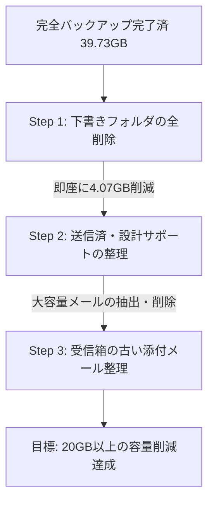

# 📧 Yahoo!メール 容量最適化 ＆ 添付ファイル整理 総合実行計画書

## 1. エグゼクティブサマリー ＆ 現状の容量分析

お客様のYahoo!メール全フォルダーのバックアップ（ローカルDropbox内）の解析結果に基づき、安全かつ確実にサーバー容量を削減するための実行計画を策定いたしました。

### 📊 フォルダー別 容量ランキング（全39.73 GB / 140,364 通）
上位4つのフォルダーだけで **約37.76 GB（全体の約95%）** を占めています。

| 順位 | フォルダー名 | 容量 | メール通数 | 構成比 | 主な用途・特徴 |
| :---: | :--- | :---: | :---: | :---: | :--- |
| **1** | **Sent (送信済み)** | **12.97 GB** | 11,562 通 | 32.6% | CAD図面・パース・見積書等の大容量添付ファイルの送信履歴 |
| **2** | **Inbox (受信箱)** | **11.40 GB** | 77,601 通 | 28.7% | 過去すべての受信メール（図面添付、業者連絡、お知らせ等） |
| **3** | **木造住宅設計サポート** | **9.32 GB** | 20,361 通 | 23.5% | 構造計算・プレカット・意匠設計関連の図面・計算書 |
| **4** | **Draft (下書き)** | **4.07 GB** | 1,998 通 | 10.2% | **大容量ファイルを添付したまま送信しなかった下書きの蓄積** |
| 5 | JC | 0.68 GB | 3,501 通 | 1.7% | 業務連絡 |
| 6 | FAX | 0.45 GB | 3,859 通 | 1.1% | 受信FAXデータ |
| 7 | UDI | 0.16 GB | 2,298 通 | 0.4% | 確認申請等 |
| 8 | Pal | 0.13 GB | 754 通 | 0.3% | パル関連 |
| 9 | 顧客 | 93.4 MB | 189 通 | 0.2% | お施主様連絡 |
| 10 | 業者 | 86.9 MB | 448 通 | 0.2% | 職人・協力業者連絡 |
| - | その他（約37フォルダー） | 約 0.46 GB | 約 17,700 通 | 1.2% | アーカイブ、その他業務 |

---

## 2. ユーザー様からのご質問への技術的回答

### Q1. 送信済み・木造住宅設計サポートから「添付ファイルだけ」削除できますか？

> **結論：Yahoo!メール公式機能としては「不可」。プログラミングによる加工も「極めてハイリスクなため非推奨」です。**

#### 理由と技術的背景
1. **Yahoo!メールの仕様**:
   - Web画面や公式アプリには、本文を残したまま「添付ファイルのみを削除する」機能はありません（メールを丸ごと削除する仕様のみ）。
2. **IMAP規格上の制限とリスク**:
   - メール規格（RFC）上、一度サーバーに保存されたメールは「変更不可（Immutable）」です。
   - 添付ファイルを削除するには、「①メールを取得 ➔ ②添付パートを切り離して本文のみで新しいメールを作成 ➔ ③サーバーへ再アップロード（APPEND） ➔ ④元のメールを削除」という手順が必要です。
   - これを行うと、**「送信日時・受信日時が“今日”に書き換わってしまう」「スレッド表示が崩れる」「メッセージIDが変わり検索が破綻する」「Yahoo側の大量メール再アップロード制限に引っかかる」** といった重大なトラブルが発生します。

#### 💡 安全かつ確実なベストプラクティス（推奨案）
- お客様の手元にはすでに **「過去すべてのメールおよび添付ファイルを含む完全バックアップ（39.73GB）」がローカル（Dropbox）に永久保存** されています。
- したがって、Yahoo!メール本体側では **「古いメール（例：3年以上前）や、5MB以上の大容量添付メール」を“メールごと”削除** しても、実質的な損失はゼロです。
- 過去の図面ややり取りが必要になった際は、ローカルバックアップからいつでも瞬時に検索・閲覧・復元可能です。

---

### Q2. Draft（下書き）のメールの全削除は簡単にできますか？

> **結論：はい、極めて簡単・安全かつ数クリック（10秒）で行えます。**

- **削除による効果**: **約4.07 GB（1,998通）** の空き容量が即座に確保されます。
- **なぜこんなに溜まっているのか**:
  大容量のPDFやCAD図面を添付したまま送信を取りやめたり、自動保存された下書きメールが蓄積しているためです。通常、過去の下書きは不要なデータです。
- **削除手順（手動）**:
  1. ブラウザでYahoo!メールを開きます。
  2. 左側フォルダー一覧の **「下書き（Draft）」を右クリック** します。
  3. メニューから **「フォルダーを空にする」** をクリックします。
  4. ゴミ箱に移動した下書きを「ゴミ箱を空にする」で完全消去します。
  ※これだけで **一瞬で約4GBの空き容量** が復活します。

---

### Q3. Inboxの添付ファイルで、1年以上前のメールの容量はどのくらいですか？

> **🎯 実測集計結果（確定値）**:
> - **Inbox総容量**: 11.40 GB（全77,601通）
> - **解析対象（100KB以上のメール）**: 7,866通
> - **【1年以上前のメール】添付ファイル**: **7,309 件 ／ 6.09 GB (6,241.2 MB)**
> - **【直近1年以内のメール】添付ファイル**: **297 件 ／ 0.29 GB (298.1 MB)**
> 
> ※**添付ファイル総容量の約95.5%（6.09 GB）が「1年以上前の過去メール」**に集中していることが判明いたしました。直近1年分はわずか0.29GB（297件）のため、1年以上前の古いメールを整理するだけで、**Inbox単体で約 6.09 GB（メール全体を含めると約8〜9GB）の空き容量を安全に回復**できます。

---

## 3. 安全・確実な容量削減のための推奨実行ロードマップ

データ消失のリスクを完全にゼロにしつつ、最大の効果を得るための3段階ステップをご提案いたします。

### 【Step 1】リスクゼロ・即効対応（目標削減: 約4.07 GB）
- **対象**: `Draft`（下書き）フォルダー
- **作業内容**: 下書きフォルダーを空にする。
- **安全性**: 過去の業務データへの影響は実質皆無。

### 【Step 2】大容量メールの重点整理（目標削減: 約10.0 〜 15.0 GB）
- **対象**: `Sent`（送信済み 12.97GB）および `木造住宅設計サポート`（9.32GB）
- **作業方針**:
  - 送信済みメールや設計サポート内の「5MB以上」「10MB以上」の添付ファイル付きメール（主に過去完了した物件のCAD・高解像度パース・構造計算書）を抽出。
  - ローカルに保存されていることを確認した上で、サーバー側から削除。

### 【Step 3】受信箱（Inbox）の長期保管メール整理（目標削減: 約5.0 〜 8.0 GB）
- **対象**: `Inbox`（受信箱 11.40GB）のうち「1年以上前のメール」
- **作業方針**:
  - 1年以上前の大容量添付メール、あるいはメルマガ・通知等の不要メールを一括整理。

---

## 4. 次のアクションとお施主様（ユーザー様）へのご確認

勝手な削除や実行は一切行いません。上記の計画内容をご確認いただき、以下の点についてご希望をお聞かせください：

1. **下書き（Draft 4.07GB）の削除**:
   - まず下書きフォルダーの全削除から着手してよろしいでしょうか？（ブラウザでの操作方法のご案内、または自動スクリプトのいずれでも対応可能です）
2. **送信済み・設計サポートのメール整理基準**:
   - 「〇年以上前のメールを一括削除」または「〇MB以上の大容量添付メールのみを抽出して削除」のどちらの切り口が業務上扱いやすいでしょうか？
